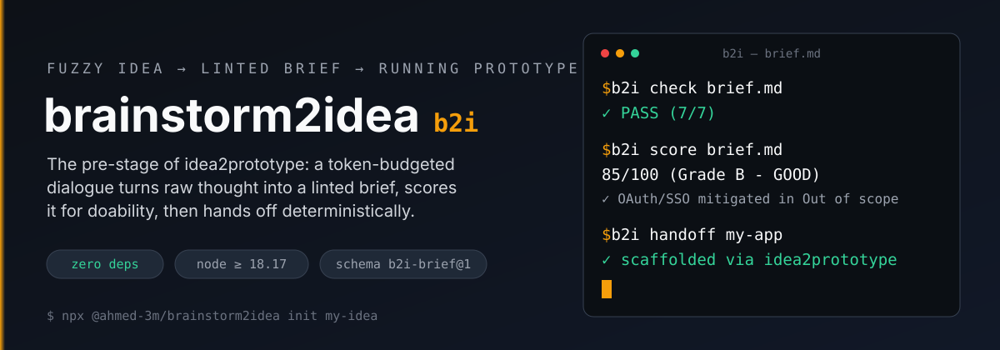
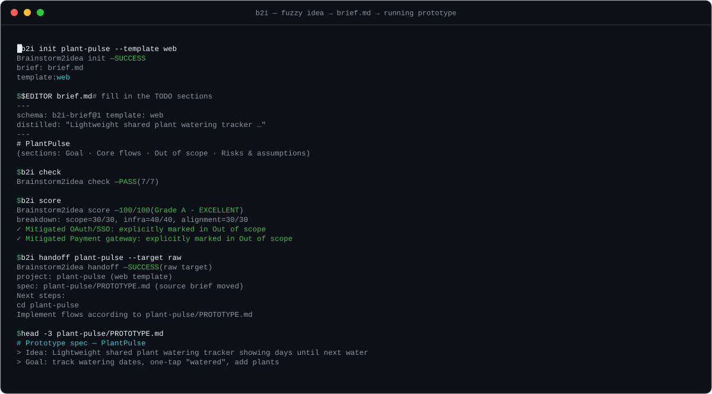
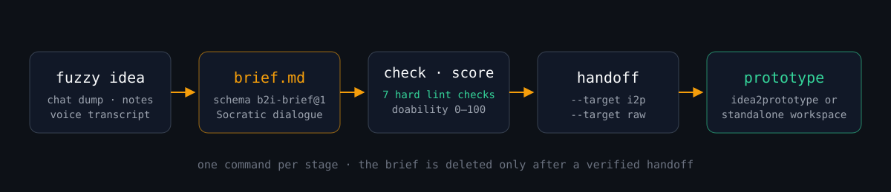

<div align="center">





[](https://www.npmjs.com/package/@ahmed-3m/brainstorm2idea)
[](https://github.com/ahmed-3m/brainstorm2idea/actions/workflows/ci.yml)
[](package.json)
[](package.json)
[](LICENSE)

</div>

Every prototyping tool assumes your idea arrives already articulated. **brainstorm2idea (`b2i`)** owns the seam before that: it interviews a fuzzy idea through a token-budgeted Socratic dialogue, writes it as a machine-linted `brief.md`, scores it for doability, and hands it off deterministically to [idea2prototype](https://github.com/ahmed-3m/idea2prototype) — or to any stack you like. Zero dependencies, pure Node.js.

```bash
npx @ahmed-3m/brainstorm2idea init my-idea && $EDITOR brief.md
npx @ahmed-3m/brainstorm2idea check && npx @ahmed-3m/brainstorm2idea score
npx @ahmed-3m/brainstorm2idea handoff my-idea
```

```text
Brainstorm2idea check — PASS (7/7)
Brainstorm2idea score — 85/100 (Grade B - GOOD)
  ✓ Mitigated OAuth/SSO: explicitly marked in Out of scope
```

## How it works



The brief is a contract, not a conversation log. Every stage is a single deterministic command; the brief file is deleted only after a verified handoff, never before.

## Quickstart

### In a coding agent (Antigravity, Claude Code, ZCode)

In Claude Code, add this repo as a marketplace, then install the plugin (skill + slash commands):

```bash
/plugin marketplace add ahmed-3m/brainstorm2idea
/plugin install brainstorm2idea@brainstorm2idea
```

Load the `brainstorm2idea` skill or run a slash command. The agent asks 3–5 adaptive questions, drafts the brief, requests your approval, writes `brief.md`, checks and scores it, then offers handoff.

```bash
/b2i "A recipe box app that lets cooks save recipes with tags and search them offline"
```

| You have… | Run |
|---|---|
| A raw idea | `/b2i "<idea>"` — full Socratic dialogue |
| A messy transcript | `/b2i-dump "<voice memo or chat dump>"` — fast de-noiser |
| No idea yet | `/b2i-spark "developer tools"` — browse 30 curated archetypes |
| An approved brief | `/b2i-export --format prompt` — kickoff prompt, checklist, or PRD |

### As a standalone CLI

```bash
# Scaffold a starter brief (TODO sections, schema-valid)
npx @ahmed-3m/brainstorm2idea init my-app --template cli

# De-noise a raw voice transcript into a draft brief (file or stdin)
npx @ahmed-3m/brainstorm2idea dump transcript.txt
cat voice-memo.txt | npx @ahmed-3m/brainstorm2idea dump - --output ./brief.md

# Lint and score a brief (file or stdin)
npx @ahmed-3m/brainstorm2idea check
npx @ahmed-3m/brainstorm2idea check --fix      # auto-repair quoting/schema/whitespace issues
npx @ahmed-3m/brainstorm2idea score -

# Browse the idea catalog, or seed a complete 100/100 brief to disk
npx @ahmed-3m/brainstorm2idea spark devtools
npx @ahmed-3m/brainstorm2idea spark --seed env-diff --output ./brief.md

# Export to an agent kickoff prompt, GitHub checklist, or one-page PRD
npx @ahmed-3m/brainstorm2idea export brief.md --format prompt
npx @ahmed-3m/brainstorm2idea export brief.md --format prd --output PRD.md

# Hand off: merge brief into a scaffolded workspace
npx @ahmed-3m/brainstorm2idea handoff my-app                  # via idea2prototype
npx @ahmed-3m/brainstorm2idea handoff my-app --target raw     # zero-dep markdown workspace (Python, Go, Rust…)
```

## The brief contract (`b2i-brief@1`)

One `brief.md` in your working directory:

```markdown
---
schema: b2i-brief@1
template: web            # web | api | cli | worker | library | none
distilled: Recipe box that lets cooks save recipes with tags and search them offline
---
# Recipe Box

## Goal
- Save recipes with tags
- Search and filter recipes offline

## Core flows
1. Save recipe: user submits title, ingredients, and tags
2. Search recipes: user filters recipes by tag or ingredient offline

## Out of scope
- Cloud synchronization or user authentication
- Paid subscription or payment processing

## Risks & assumptions
- ASSUMPTION: browser local storage or IndexedDB is sufficient for offline data

## Notes
- Keep UI minimal and keyboard-friendly
```

`b2i check` enforces seven hard rules — schema, name, template, goal (1–3 bullets), flows (1–3 numbered), out-of-scope (≥1 bullet), distilled (≤200 chars) — and surfaces at most three failure notes, so agent iterations stay cheap.

## Doability scoring (`b2i score`)

`b2i score` answers "can this actually be prototyped in a weekend?" on a 0–100 scale with letter grades:

- **Scope discipline (30 pts)** — rewards explicit non-goals.
- **Rabbit-hole immunity (40 pts)** — detects high-risk patterns (`auth`, `payments`, `multi-tenant`, `crypto/blockchain`, `custom ML training`, `native apps`, `real-time video/audio`). Marked in `## Out of scope` → safely mitigated; left in `## Core flows` → advisory deduction.
- **Template fit (30 pts)** — concise goals, demoable flows, explicit `ASSUMPTION:` / `RISK:` tags.

## Why not X?

| Dimension | `b2i` | `/grill-me` | GitHub Spec Kit | BMAD-METHOD |
|---|---|---|---|---|
| **Primary stage** | Fuzzy idea → brief | Plan → polished plan | Requirements → code | PRD → epics |
| **Automated linting** | 7 hard checks | Manual agent review | PR checks / schema | Manual review |
| **Doability scoring** | 0–100, rabbit-hole quarantine | Conversational | Static guidelines | Persona reviews |
| **Downstream handoff** | 1-step scaffold | None | Manual scaffolding | Manual creation |
| **Runtime overhead** | **Zero npm deps** | Prompt command | Node / Python CLI | 30-persona overhead |
| **Token discipline** | ≤3 failure notes | Full context | Full spec | Very heavy |

`b2i` is not a planner and not a scaffolder — it is the lintable contract *between* your idea and the tools that build it.

## Idea discovery (`b2i spark`)

For blank-canvas paralysis: 30 curated prototype archetypes across 6 domains (`devtools`, `productivity`, `local-ai`, `automation`, `cli`, `web`) — including frequently requested starters like a browser extension (`link-grabber`), a Discord standup bot (`discord-standup`), a CSV cleaner, a flashcard trainer, and a terminal game. Every archetype passes `b2i check` 7/7 and scores 100/100 with rabbit holes pre-quarantined.

## Benchmarks & dogfood

The [pre-registered suite](benchmarks/specs.md) defines 5 canonical ideation scenarios (rambling voice memo, Frankenstein SaaS, infra rabbit hole, library utility, non-software idea) with a fixed evaluation rubric. `tests/benchmarks.test.mjs` executes them on every CI run (Node 18/22/24, Linux + Windows); the full suite finishes in a few seconds.

Results against the rubric's ideal target briefs (engine-measured, `v0.4.x`):

| # | Scenario | Challenge | Template | `b2i check` | `b2i score` | Rabbit holes quarantined |
|---|---|---|---|---|---|---|
| 1 | PlantPulse | Rambling voice memo → de-noised brief | `web` | 7/7 | **100/100 A** | 2 (auth, payments), 0 leaked |
| 2 | PawsOnDemand | Frankenstein SaaS → scope-cut | `web` | 7/7 | **100/100 A** | 2 (payments, native app), 0 leaked |
| 3 | CollabMark | Distributed-infra rabbit hole → simplicity | `web` | 7/7 | **100/100 A** | 2 (OAuth/SSO, distributed infra), 0 leaked |
| 4 | kv-log-parse | Zero-dep library utility | `library` | 7/7 | **100/100 A** | 0 (none present) |
| 5 | Kreuzberg Book Swap Cafe | Non-software honesty check | `none` | 7/7 | **100/100 A** | 1 (payments), 0 leaked |

Every scenario also satisfies the rubric's scope-discipline limits: 2 goals, 3 flows, 3–5 explicit non-goals, and honest `template: none` classification for the non-software case.

- [dogfood/chunk-summarizer](dogfood/chunk-summarizer) — a real library prototyped end-to-end using `b2i export` + raw handoff.

## Community

- [Contributing](CONTRIBUTING.md) — zero-setup dev environment (no `npm install` — really), architecture map, and the non-negotiable constraints.
- [Discussions](https://github.com/ahmed-3m/brainstorm2idea/discussions) — ideas, questions, and show-and-tell.
- [Issues](https://github.com/ahmed-3m/brainstorm2idea/issues) — bugs; grab something labeled [`good first issue`](https://github.com/ahmed-3m/brainstorm2idea/labels/good%20first%20issue).

## License

MIT © The Brainstorm2Idea Authors
